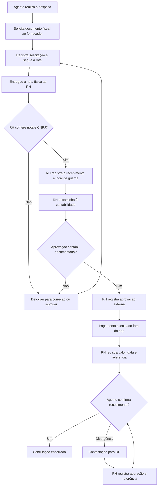

# Auditoria de telas e fluxos — MODO ROTEIRIZADOR

Atualizada em 11/11/2026. Branch: `fix/modo-roteirizador-auditoria-ux`. Registro operacional e verificável; não declarar tudo funcional sem percorrer os estados autenticados.

## Níveis de validação

- **Código**: rota e controle de acesso revisados no GitHub.
- **CI**: TypeScript, ESLint e compilação Next.js.
- **Smoke**: servidor HTTP acessível, páginas não retornam 404 e fotografias de login carregam.
- **E2E real**: operação no navegador logado por perfis, permissão GPS/câmera, banco, upload, mudança de parada, central; requer contas adequadas e teste manual ou Playwright autenticado.

**Importante:** CI e smoke NÃO provam o funcionamento das funcionalidades com dados reais.

| Tela | URL | Avaliação/ação nesta etapa | Teste pendente |
|---|---|---|---|
| Acesso | /login | Foto desktop e mobile versionada, layout responsivo revisado | Entrar com conta ativa, senha errada, mobile real |
| Criação de conta | /login (aba) | Preserva validação, solicitação e role exclusivamente no servidor | E-mail e perfil pendente sem acesso interno |
| Recuperar senha | /login (aba) | Mantém Neon Auth e retorno de sucesso/erro | E-mail real, redirect confiável e expiração |
| Redefinir senha | /redefinir-senha | Página presente, token query/hash, erro e confirmação | Link real do Neon Auth sem 404 |
| Solicitação | /aguardando | Página presente e leitura de `/api/access-requests` | Aprovação/recusa com usuários distintos |
| Convites | /convite | Página pública testável por HTTP | Convite expira/revogação/redeem |
| Início central | /dashboard | Smoke e módulo de métricas | Totais conferidos na base |
| Meu dia | /agente | Smoke e acesso por papel | Rota ativa/publicada + próxima parada |
| Empresas | /empresas | Código/API revisados; filtro inválido devolve 400 | Paginação, CNAE, CNPJ, duplicata e estados vazios |
| Campanhas | /campanhas | Código/API revisados; validação devolve 400 | Criar, filtrar, período e orçamento |
| Cadastros sindicais | /cadastros | Backend exige admin para alterar | Confirmação manual e auditoria |
| Rotas | /rotas | Corrigida detecção de papel; 49 paradas inseridas de forma atômica | Criar/publicar, limite, reentrada e conflito |
| Percurso | /rotas/[id] | Backend preservado | Endereços sem coordenadas, quota e mapa |
| Visitas | /visitas | GET por agente, POST legado bloqueado | Foto obrigatória, formulário e próxima visita |
| Jornada guiada | /campo/[id] | Acesso restrito à rota atribuída; layout mobile do projeto preservado | Teste no celular com GPS/câmera, pin e swipe |
| Validações | /validacoes | Backend e fluxo de foto revisados estaticamente | Aprovar/recusar, evidência, expurgo após análise |
| Despesas | /reembolsos | Agente não pode enviar despesa em campanha sem rota própria | Lançar, aprovar, rejeitar e recibos |
| Mapa de cobertura | /mapa | Smoke e API de território | Dados por município, render e performance |
| GPS equipe | /localizacoes | API tem escopo de agente e central; dados recentes | Consentimento, frequência, perda de sinal |
| Equipes | /equipes | Só administrador aprova cadastros no servidor | Permissão por perfil e segurança da troca |
| Relatórios | /relatorios | Corrigido vazamento dos custos de outros agentes; CSV preservado | Valores, escopo, download |
| Importações | /importacoes | Lotes inválidos devolvem erro 400, não 500 | CSV inválido/duplicado, log |
| Configurações | /configuracoes | Diferencia perfil e módulo administrativo | Atualização do perfil e recuperação |
| Limpeza de testes | /limpeza | API exige admin e confirmação | Prévia e exclusão **somente** com autorização |
| Menu e dock | Global | Visual preto e laranja; opções por papel; jornada imersiva sem dock | Tab/teclado, iOS safe-area e menu Mais |

## Correções encontradas durante a auditoria

1. **Imagem ausente no login**: duas fotos WebP locais incorporadas, removida dependência da URL não confiável, CSS reorganizado.
2. **Respostas falsas de sucesso**: `withRole` agora retorna HTTP 400 quando o módulo sinaliza `{error:...}`, evitando mensagens de operação concluída após falha.
3. **Roteiro por papel**: `/rotas` agora consulta `/api/me`, não infere agente de falhas nas APIs administrativas; agentes não carregam listas desnecessárias.
4. **Criação incompleta de rotas**: inserção de uma rota e até 49 paradas no mesmo SQL atômico.
5. **Privacidade de relatórios**: agentes recebem somente campanhas com rotas atribuídas e despesas próprias.
6. **Despesa não atribuída**: bloqueada tentativa do agente de lançar custo em campanha alheia.
7. **Importação inválida**: lote vazio, fora do limite ou item inválido não deve gerar erro 500.
8. **CI legado**: removida permissão de escrita e modificação automática do lockfile; incluída verificação HTTP de 21 páginas e de ambas as fotografias.
9. **Identidade dos painéis**: dock escuro com contraste e laranja, mantendo mecanismos de autorização existentes.

## Pendências de homologação real

- **CI: passou** na execução `43056342215` (TypeScript, ESLint, Next build e smoke HTTP). O smoke havia falhado por buscar a mensagem de 404 no payload RSC de páginas válidas; agora considera status HTTP e título 404 efetivo.
- Publicar Preview com conexão ao Neon **isolada** do banco de produção.
- Validar pessoalmente foto, geolocalização, acesso, recuperação de senha e fluxos de cada papel, pois a autenticação real e as permissões do celular não podem ser simuladas por smoke HTTP.
- Monitorar erros de servidor por logs da Vercel quando disponíveis. Em Hobby, retenção é curta; não inferir ausência de erros quando log indisponível.
- Levantar problemas da UI com imagens reais de cada tela e corrigir contraste, textos, estados e sobreposição.
- Testar fluxo de até 49 empresas em uma mesma rota usando dados de Preview.
- Implementar papel Marketing apenas com política de permissões definida no servidor e telas específicas.
- Limpar dados de teste **somente após confirmação explícita**; depois planejar base externa/ngrok.

## Revisão complementar de 11/11/2026

10. **Smoke do Next.js**: corrigido falso 404 causado pelo texto de fallback no payload de React Server Components; CI verde.
11. **Rotas por link direto**: rota em rascunho não pode ser consultada por agente, mesmo conhecendo o UUID.
12. **GPS inválido**: check-in e telemetria recusam coordenadas ausentes, nulas ou não numéricas, impedindo conversão de `null` para `0,0`.
13. **Campanhas e reembolsos**: agente só vê como disponíveis campanhas com rota atribuída e publicada (ou já iniciada/concluída), e o servidor impõe a mesma restrição ao salvar despesa.
14. **Responsividade em Campanhas**: removida grade forçada de duas colunas em telas pequenas; campos, botões e tabelas têm regras de legibilidade/tamanho mínimo no mobile.
15. **Visitas com sessão inválida**: não chama API administrativa como fallback quando `/api/me` falha; exibe erro e instrução de reconexão em vez de lista vazia.

### Limitações não mascaradas por CI
- E2E real: revisão de visita, foto, GPS, aprovação, navegação orientada e recuperação de senha depende de contas reais e permissões do dispositivo.
- Concorrência de múltiplos check-ins no mesmo `stop_id`: esquema inicial não possui constraint `unique(stop_id)` em `visits`. A proteção `where not exists` pode sofrer corrida. Recomenda-se migração aditiva em branch Neon de teste, com análise prévia de duplicados; **não aplicar automaticamente à produção**.
- Não confundir Preview READY com teste de funcionalidades: é necessário conferir autenticação com os três perfis.

## Verificação do Neon e dos logs (somente leitura)

- Branch de Preview consultada: `br-quiet-morning-b62b1q3e` (não é a principal). Contagem: 1.848 empresas, 2 rotas, 4 visitas, 5 perfis, 1 visita ainda em andamento e 1 parada sem coordenada. Check-ins duplicados por parada: 0.
- Logs de produção das últimas 24h incluem erros **históricos** de migrações não instaladas (GPS, notas de revisão e expurgo). Consulta posterior do esquema mostrou que as colunas e a tabela de GPS **já existem** nos bancos principal e Preview; portanto não tratar esses logs anteriores como erro ainda ativo.
- **Pendência confirmada:** `admin_delete_test_record(text,uuid,text)` não existe nem no Neon principal nem no Preview. O endpoint passou a informar `deletion_available=false` e a interface desabilita exclusões em vez de apresentar erro genérico. Aplicação de `neon/005_limpeza_segura.sql` permanece para etapa futura, após backup e aprovação.
- **Tela Visitas do agente corrigida:** além da lista de jornadas para novo registro, apresenta agora o histórico próprio de visitas e o status de revisão.
- A limitação diária da Vercel impediu novo deploy manual do commit mais recente (HTTP 402 `api-deployments-free-per-day`). Deploy anterior READY não equivale à versão atual. CI no GitHub permanece como validação não autenticada.

## Continuação: consistência e segurança operacional (11/11/2026)

- **Check-in simultâneo:** reserva da parada via atualização condicional `pending → arrived` e criação de visita/log no mesmo comando SQL. Segundo check-in recebe conflito; migração com unicidade em `visits(stop_id)` segue recomendada como defesa adicional, apenas após análise dos dados.
- **Finalização:** respostas, conclusão e status da parada + log gravados atomicamente. Ao reenviar visita solicitada para ajuste, limpa metadados da decisão anterior.
- **GPS de navegação:** endpoint de trecho rejeita `null` e campos ausentes em vez de convertê-los em coordenadas zero. Ping após 15 minutos sem atualização não responde falsamente como posição transmitida; exige reiniciar com consentimento.
- **Fotos:** foto expirada não conta como foto válida; o agente pode reenviar a fachada se ela expirou durante uma visita aberta. Limpeza programada elimina só imagens vencidas de visitas pendentes, preservando eventual imagem nova; análise concluída continua removendo todas as imagens.
- **Empresas para agente:** listagem não revela empresas associadas apenas a rotas em rascunho ou canceladas.

**Validação:** revisão estática do código; executar CI no commit e repetir os testes autenticados no Preview antes de qualquer merge. Nenhum banco ou dado de produção foi modificado nesta correção.

### Ajustes de navegação e estados de rede (11/11/2026)
- O portal diferencia falha de rede/servidor na consulta de sessão de um acesso realmente negado e oferece ação de nova tentativa. Falhas transitórias não são mais tratadas silenciosamente como perfil sem permissão.
- O link da marca retorna o agente a **Meu dia** sem abrir o dashboard administrativo primeiro.
- Depois de login aprovado, a navegação reconhece o perfil e encaminha o agente diretamente a `/agente`.
- Nova validação: TypeScript, lint, build, smoke e Preview; confirmar funcionamento autenticado por perfil antes de merge.

### Correções de telas de planejamento e campo (11/11/2026)
- Empresas: ação de importação visível somente para administração/supervisão; listagem não mantém resultados antigos quando uma consulta falha; legenda diferencia base de trabalho de dados definitivos; maior legibilidade dos nomes.
- Rotas: etiquetas de situação em português e ações coerentes com jornada iniciada/concluída; campo de busca adapta-se no celular e seleção de empresas tem linhas de toque maiores.
- Reembolsos: ações de aprovação exigem perfil confirmado de admin/supervisor, sem assumir autorização em caso de falha da sessão; erros ao carregar campanhas deixam de ser silenciosos; situações em português e aviso quando não há campanhas atribuídas.
- Nenhum acesso administrativo foi concedido no cliente: as restrições de servidor continuam sendo a fonte de verdade.

### Conclusão e reabertura de jornada; segurança de convites (11/11/2026)
- A última parada concluída marca a rota como `completed` no mesmo SQL que registra as respostas, desde que todas as demais paradas estejam `visited`. O dashboard passa a mostrar a rota como concluída.
- Quando a central solicita ajustes (`needs_more`), a parada volta para `arrived` e uma rota antes concluída é reaberta em `in_progress` no mesmo comando que registra a decisão. Isso permite ao agente reenviar as respostas e retomar o GPS mediante consentimento.
- Aceitar um convite exige uma conta Neon Auth com **e-mail verificado** e exatamente igual ao convite. O critério é aplicado dentro do próprio SQL que consome o token, protegendo inclusive convites de administrador.
- Mudanças pendentes de CI, de homologação autenticada e de Preview, sem aplicação de migrações ou alterações em bancos.

## Sprint 2 — navegação de campo, rotas e inteligência territorial (11/11/2026)
- Relato de homologação real: agente precisava recarregar a página ao sair de uma rota e iniciar outra; o GPS podia estar indisponível enquanto a interface indicava navegação ativa. Ajustado componente da rota com identidade `key={id}`, limpeza de listeners e atualização do trecho ao mudar de parada.
- Modo direção: prioriza mapa, instrução e destino, com confirmação discreta de chegada; removeu controles explícitos de parar GPS da interface. Permissão do navegador continua obrigatória. Agente deve usar o celular somente com veículo parado.
- Login: composição responsiva revisada, fotografia local preservada, contraste e legibilidade; qualidade intrínseca da foto original pode requerer substituição por asset de maior resolução.
- Plano/agrupamento técnico `campaigns` preservado por compatibilidade, mas rota pode ser criada diretamente sem campanha manual. Área legada `/campanhas` redireciona a `/rotas`.
- Cadastros sindicais: apenas `field_status='validated'` + registro administrativo `confirmed` com data efetiva. Confirmação administrativa passa a ser realizada em Empresas e exige referência.
- Mapa de cobertura: 645 polígonos oficiais de SP (IBGE/geodata-br, CC0) sob consulta remota cacheada, métricas de captação por município/período e detalhes por status de cada empresa. Período é `establishments.created_at`, NÃO data de abertura de empresa ou data de conversão.
- Acesso de mapa e detalhes somente admin/supervisor; agente mantém acesso às rotas atribuídas.
- **Não houve migração de banco nem importação das ~200 mil empresas externas.** Integração ngrok permanece fora de escopo desta sprint.
- **Homologação obrigatória:** teste real troca de rotas, permissões do navegador, comportamento com GPS negado, 645 polígonos recebidos no Preview, fluxos administrativos e foto em Blob separado antes de merge. CI e build não equivalem a E2E autenticado.

## Correção GPS entre jornadas — 11/11/2026

- **Reprodução relatada pelo agente:** após concluir uma rota e abrir outra, a tela exibiu “Autorize o GPS...” apesar de a localização estar autorizada e ter funcionado anteriormente. Exigia refresh.
- **Causa identificada no código:** `gpsOnce` tratava os códigos de erro 1, 2 e 3 do navegador como uma única falha de permissão. Cada nova rota exigia medição GPS de alta precisão, com `maximumAge:0`, sem reaproveitamento de posição válida recente. Falha do `watchPosition` podia manter badge “GPS ativo”.
- **Correções:** mensagens específicas para permissão, indisponibilidade e timeout; uso de última medição somente por período curto e após consentimento, quando a permissão continua concedida; fallback de precisão; botão “Reativar GPS” sem atualizar a página, com solicitação nova e nova geração de watch; estado explícito “Sinal GPS instável”; checagem de precisão no check-in; otimização da rota não bloqueia o usuário esperando sinal; stop/beacon permanece isolado por rota.
- **Login:** menor escurecimento do fundo, ajustes de posicionamento/contraste; fontes das imagens no GitHub continuam com resolução 980×402 desktop e 560×534 mobile. Para alta definição genuína, substituir a fotografia por original com pelo menos 1920px de largura. Não distorcer nem trocar a identidade visual da imagem.
- **QA pendente:** navegador com GPS permitido, sem posição, timeout, bloqueio efetivo, aba oculta/visível, troca imediata entre rotas e confirmação de chegada parado; avaliar desktop e celular. Homologação deve ser em Preview com Neon isolado. Não testar fotos com Blob compartilhado.

## Nova etapa Cadastro Sindical — 11/11/2026

- Usuário definiu quarto cargo interno `cadastro` para confirmar empresas já validadas no sistema oficial do SindPetshop-SP. Etapa independente da supervisão, que mantém controle sobre validação de visitas.
- Adicionadas fila de conferência e lista de confirmados, com referência obrigatória e declaração afirmativa de conferência externa. API confirma em operação atômica com auditoria e proíbe sobrescrever confirmação oficial anterior.
- Preservados registros históricos; novo campo `official_verified_at` nulo por padrão. O histórico `state='confirmed'` só passa a compor a lista de confirmados depois de conferência real.
- Cargos selecionáveis em aprovação de pedidos e criação de convites; remanejamento administrativo de perfil existente não-admin, sem permitir alteração para `admin` nem troca de administrador.
- Revisados controles server-side nas APIs de despesas, rotas, visitas, cobertura, relatórios, equipe; não depender de esconder links na UI.
- Nenhuma migração Neon aplicada nesta implementação: SQL disponível em `neon/008_perfil_cadastro.sql` para homologação controlada, sem alteração no banco principal.
- QA e deploy ainda bloqueados pela necessidade de migração no Neon Preview e homologação dos quatro papéis; merge não autorizado.

## Módulo RH — reembolso de despesas de campo (11/11/2026)

Fluxo inspirado no mapa operacional enviado pela equipe:

- **Perfil `rh`**: fila de reembolsos, registros fiscais, conferência externa e conciliação; não administra rotas, visitas, importações, cadastros sindicais, GPS ou outras contas. Administradores veem histórico mas **não registram pagamentos**; só o RH pode alterar etapas financeiras.
- **Agente**: formulário de solicitação ligado a rota atribuída, descrição, categoria, valor e data; pode informar referência e CNPJ destinatário da nota; entrega **original físico** ao retornar. Somente o titular pode corrigir devoluções, confirmar recebimento ou contestar pagamento.
- **RH**: recebimento físico exige referência da nota, CNPJ destinatário verificado manualmente, referência de arquivamento e confirmação expressa. Se `SINDPETSHOP_CNPJ` estiver configurada, o servidor também confere igualdade exata do CNPJ indicado. Sem essa variável, a conferência depende do RH; não insinuar verificação automática.
- **Contabilidade**: não há autenticação/integrador contábil nesta versão. RH registra **quem** aprovou externamente e **qual o protocolo**. Não deve marcar aprovação sem evidência.
- **Pagamento**: somente após aprovação contábil, registrando valor exato, data, meio e referência do pagamento realmente executado; o sistema **não efetua transferências**. O agente ainda confirma ou contesta o efetivo recebimento. Conflitos permanecem visíveis até resolução documentada e confirmação do trabalhador.
- **Trilha auditável**: tabela `expense_events` registra todas as mudanças relevantes, ator, instante e dados mínimos para auditoria; inserção de evento no mesmo comando SQL da transição. `audit_logs` continua recebendo eventos correlatos.
- **Migração**: `neon/009_rh_reembolsos.sql` (aplicar **depois** da 008) acrescenta cargo RH, campos de nota física, conferência contábil, pagamento, conciliação e trilha. Não aplicar automaticamente no Neon principal. O armazenamento de comprovantes eletrônicos/XML e sua retenção legal são processos externos até existir storage segregado e política aprovada.
- **Privacidade**: não armazenar número de conta, chave PIX do colaborador, CPF de terceiros ou foto de nota em observações livres. Apenas identificador de operação, referência fiscal e informações estritamente necessárias.
- **Homologação**: testar papéis admin/agente/supervisor/cadastro/rh; agente não vê despesas de outros; supervisor e cadastro sem consulta financeira; RH não acessa API de rota; bloqueio de aprovação sem nota física, contabilidade ou pagamento executado; rejeição de dupla confirmação, histórico completo, contestação do agente e resolução.
- **Fiscal/contábil**: a nota fiscal é emitida pelo fornecedor, não pelo agente nem pelo app. CNPJ do sindicato como destinatário é regra operacional a confirmar com contabilidade conforme tipo de documento. Guardar XML, DANFE/recibo original e comprovante de transferência conforme política de retenção e legislação. Referências: Receita/SEFAZ-SP https://legislacao.fazenda.sp.gov.br/Paginas/RC24860_2021.aspx ; Portal NF-e https://www.nfe.fazenda.gov.br/Portal/perguntasFrequentes.aspx.

### Atualização de documentos fiscais — 11/11/2026
- O CNPJ pode conter letras e números (novas inscrições alfanuméricas de 2026); captura fiscal aceita 14 caracteres alfanuméricos. Não normalizar removendo letras. Fonte oficial: https://www.gov.br/receitafederal/pt-br/acesso-a-informacao/acoes-e-programas/programas-e-atividades/cnpj-alfanumerico
- No recebimento da nota física, RH registra CNPJ do **emitente**, CNPJ do **destinatário** (sindicato), referência da nota e, quando disponível, **chave fiscal de 44 caracteres**. O banco impede usar a mesma chave fiscal em duas despesas ativas. Sem chave, continuam obrigatórias a conferência humana e a política de controle de duplicatas da contabilidade.
- Não consultar chave fiscal automaticamente em portais com CAPTCHA ou sistemas externos sem integração autorizada; o campo registra evidência declarada e requer conferência manual.
- A variável `SINDPETSHOP_CNPJ` é opcional: quando configurada no servidor, além da declaração do RH, ocorre checagem de igualdade do destinatário. Sem ela, o código não promete validação automática.

### Controles adicionais do fluxo RH
- **Idempotência de solicitações**: aplicativo envia UUID por tentativa lógica de despesa; falha de internet e reenviar a mesma solicitação não criam registros duplicados (índice único `expenses.client_request_id`, retorno do ID original).
- **Segregação de funções**: um ex-agente que receba o cargo RH não pode movimentar/aprovar suas próprias despesas históricas (403 no servidor, botões ocultos).
- **Pagamentos legados**: marcações antigas de `paid` sem data ou referência de transferência não podem ser reconhecidas como recebidas pelo funcionário; precisam de conciliação externa.
- **Datas**: despesa futura e pagamento bancário informado como futuro são recusados; data do pagamento real é independente da data em que o RH registrou o lançamento.
- **Controle de duplicidade fiscal**: chave fiscal (quando fornecida) tem índice único enquanto a despesa estiver ativa; sem chave, a contabilidade/RH ainda precisa verificar fisicamente.
