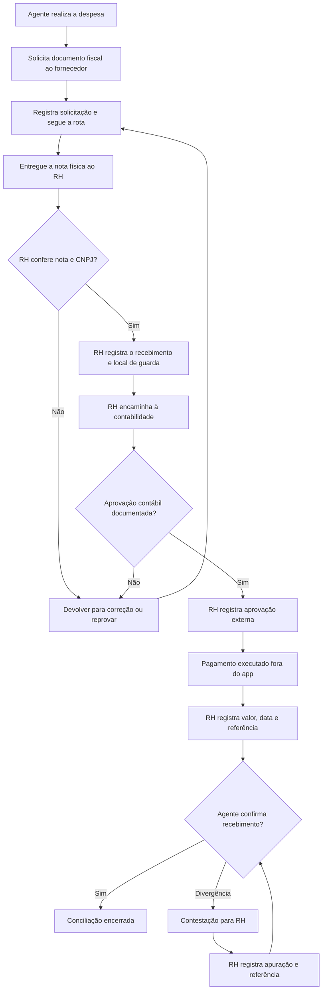

# MODO ROTEIRIZADOR — referência central do projeto

> **Palavra-chave de continuidade:** `MODO ROTEIRIZADOR`.
> Quando o usuário mencionar essa expressão, consultar este arquivo e, em seguida, verificar o estado real do GitHub, Neon e Vercel antes de sugerir ou modificar qualquer funcionalidade. Este documento preserva o contexto do projeto; não substitui o estado atual do código, testes ou serviços.

## 1. Visão e propósito

Projeto **SindPetshop-SP · Campo & Território** — plataforma web responsiva de planejamento, gestão territorial, campanhas, roteirização e validação de visitas a empresas do setor pet do Estado de São Paulo. Operada pelo SindPetshop-SP, com forte foco em usabilidade por agentes de campo, inclusive pessoas idosas e com pouca familiaridade com aplicativos.

Objetivo: centralizar ações da equipe sem parecer CRM tradicional. A experiência mobile deve se aproximar da clareza operacional de apps de deslocamento (Waze, Google Maps, Uber, 99) sem copiar marcas ou prometer serviços inexistentes. **Um passo importante por tela**, tipografia acessível, ações grandes, nomes claros, baixo ruído visual e retorno imediato após o toque.

### Escopo de usuários e permissões

Roles reais em `lib/access.ts`: `admin`, `supervisor`, `agent`. Gestão de sessão via Neon Auth + tabela `app_profiles` no Neon/Postgres. Solicitações via `access_requests`; aprovação **exclusiva do admin**, após verificar e-mail, concede perfil e ativação. Agentes jamais podem aprovar ou alterar as próprias permissões. Marketing como perfil próprio é objetivo futuro: **não criar atalhos/autorizações sem modelo de acesso explícito no backend**.

- **Agente de campo**: Meu dia, Minha jornada, confirmar chegada, foto da fachada, formulário de visita, meus resultados, despesas, perfil; visualizar somente as rotas e empresas atribuídas.
- **Supervisor**: acompanhar as equipes, roteiros, visitas e resultados segundo as regras do servidor; não conceder `admin` nem aprovar cadastros sem autorização explícita.
- **Administrador**: gestão global, campanhas, empresas, roteiros, atribuições, validações, acompanhamento e relatórios; configurações e limpeza segura de testes.
- **Marketing** (futuro): campanhas, mapas e indicadores; precisa de role/permissões dedicados, sem reaproveitar `admin` por conveniência.

## 2. Jornada ideal do agente

1. Entrar com senha no sistema; a conta só acessa dados internos depois de aprovação administrativa.
2. Abrir **Meu dia** e receber a próxima rota atribuída com ação óbvia de **Iniciar jornada**.
3. Ver o mapa no próprio aplicativo, com sua localização, paradas numeradas, próxima empresa e trajeto viário sugerido.
4. Iniciar acompanhamento de GPS **com consentimento**, mostrar condição do sinal e atualizar a central durante trabalho.
5. Em trânsito, mostrar a próxima orientação, distância e aproximação; permitir ampliar, centralizar, recalcular e ver empresas usando **menu secundário**.
6. Ao chegar, deslizar **Cheguei** ou usar alternativa acessível por toque. Exibir feedback de processamento, aproveitar posição GPS recente e avançar sem buscar toda a rota novamente.
7. Abrir captura da fachada (com permissão e alternativa de upload), mostrar progresso. Foto privada usada apenas como evidência de visita e eliminada pela rotina de retenção após análise. Não expor URLs públicas ou dados pessoais.
8. Questionário curto, **uma pergunta por vez**, com observações do local, funcionamento, indícios de irregularidade e campo livre, sem induzir conclusão jurídica automática.
9. Enviar ao servidor; mostrar estado de sucesso apenas após resposta confirmada; central valida posteriormente. Seguir imediatamente à **próxima parada**, ou concluir jornada e encerrar GPS no fim.
10. Tratar offline, GPS impreciso, endereço sem coordenadas, falha de API e perda de conexão com mensagens práticas, sem duplicar registros ou perder respostas.

## 3. Roteirização e dados

- A base atual contém aproximadamente **1.848 empresas inseridas para teste** (número relatado pelo usuário, não garantia do volume atual).
- A origem definitiva das empresas deve ser **outra ferramenta/base externa**, consultada por filtros como CNAE, município, região e tipo de empresa. CNAEs de interesse já discutidos: **4789-0/04**, **9609-2/08**, **7500-1/00**.
- Integração externa/ngrok **adiada conscientemente**: primeiro validar toda a ferramenta com os registros de teste. O ngrok é apenas túnel de rede; não é o banco de dados.
- Evitar duplicatas ao importar/sincronizar via CNPJ normalizado, com histórico da fonte, data de atualização e separação entre cadastro-mestre e associação a campanhas.
- Permitir **mais de 20 empresas por dia**; decomposição/otimização escalável por lotes, evitando quotas de terceiros.
- Roteamento com serviço OpenRouteService em endpoint de servidor; API key só no servidor. Distâncias e tempos exibidos são **estimados**, sem trânsito em tempo real. Se faltar coordenada ou houver quota/falha, informar e manter o mapa de paradas com alternativa segura.
- Painel administrativo de **limpeza de testes** requer restrição e confirmação, protegendo registros de produção. Nunca apagar em massa sem autorização explícita.

## 4. Produto e telas a validar

### Públicas e autenticação
- `/login`: entrar, criar conta, recuperar senha, consultar solicitação.
- `/aguardando`: status real da solicitação (pendente, aprovado, recusado) e atualização.
- `/redefinir-senha`: token válido/expirado, confirmar senha sem tela 404, integridade Neon Auth.
- `/convite`: convite controlado por administrador, se mantido.

### Centro de operações
- `/dashboard`: visão geral compreensível e indicadores reais.
- `/empresas`: busca, CNPJ, filtros, detalhes, deduplicação, origem e ações permitidas.
- `/campanhas`: criação, segmentação, status, atribuição, progresso.
- `/cadastros`: registros sindicais e validação.
- `/rotas` e `/rotas/[id]`: criar, atribuir, ordenar, calcular, monitorar e publicar.
- `/visitas`: recebimentos e histórico; garantir escopo do usuário.
- `/validacoes`: evidência, respostas, aprovação/rejeição, auditoria e exclusão segura da foto.
- `/reembolsos`: lançar, enviar, avaliar e visualizar conforme papel.
- `/mapa`: cobertura, filtros e performance no celular.
- `/localizacoes`: agentes em campo e atualização de GPS, privacidade, sinal de última leitura.
- `/equipes`: convites, aprovação, papéis e status.
- `/relatorios`: métricas precisas, filtros e exportação, conforme autorização.
- `/importacoes`: importações validadas, CSV e registros duplicados.
- `/configuracoes`: perfil, preferências e configurações permitidas.
- `/limpeza`: apenas admin, com pré-visualização de escopo e confirmação.
- `/agente`: início do dia.
- `/campo/[id]`: navegação guiada responsiva, foto, perguntas, confirmação e próxima visita.

Não confundir página renderizada/CI verde com funcionalidade real testada: realizar teste por fluxo em Preview e com cada papel autorizado.

## 5. Identidade visual definitiva aprovada

**Referência mandatória de login:** fotografia do petshop com funcionários, cães e gato, formulário funcional por cima da foto, inputs brancos, botão **laranja** e base **preta**. Links de criar conta/esqueci senha e assinatura ficam na parte inferior. As imagens que o usuário enviou são **referências da identidade**, não screenshots para usar inteiras como fundo. Não criar uma estética diferente com painel verde/creme para autenticação sem aprovação.

**Assets locais disponíveis nesta conversa:** `photo-login-desktop.webp`, `photo-login-mobile.webp`, derivados da foto limpa, além de `login_sindpetshop_sp_com_pets.png` como referência alternativa. Manter a imagem **sem texto ou formulário embutido**, para que os campos sejam HTML e responsivos. Evitar depender de URL de terceiros; preferir arquivo local versionado.

**UI interna**: simplificação progressiva, linguagem visual SindPetshop-SP (laranja, preto, textos legíveis), contraste, hierarquia forte, acabamento de apps iOS modernos, sombras discretas e dock inferior adaptável ao papel. A navegação **principal** no mobile usa no máximo 4 destinos + Mais; as opções secundárias ficam no painel Mais. No desktop, a navegação pode ser contextual, sem desperdiçar espaço.

**Acessibilidade**: alvo de toque ≥44px (ideal ≥48px para público idoso), corpo mínimo 14–16px, foco visível, labels persistentes, avisos `role=status/alert`, teclado e leitura de tela, movimento reduzido, área segura no iPhone, não depender só de arrastar.

**Mobile mapa**: mapa full screen, cabeçalho discreto, próxima instrução e empresa, CTA principal (Cheguei). Máximo de dois botões flutuantes para GPS e Mais; nenhuma barra cobrindo CTA. Evitar repetição da mesma informação em três locais. O formulário de visita fica em etapa dedicada de tela cheia.

## 6. Arquitetura e infraestrutura conhecidas

- Repositório GitHub: `Seeven777/Gest-o-de-Campo-Sind`.
- Hospedagem: Vercel, projeto `gest-o-de-campo-sind`; produção é protegida, publicar mudanças em Preview primeiro.
- Banco: Neon Postgres, projeto `seeven-mkt` (Neon Auth integrado).
- Stack: Next.js App Router 16, React 19, TypeScript, Neon Auth, Neon serverless Postgres, Leaflet/OSM, OpenRouteService, Vercel Blob para evidências.
- Credenciais somente em ambientes seguros; jamais expor `DATABASE_URL`, chaves de roteamento ou secrets no cliente ou repositório.
- Arquivos de referência: `lib/access.ts`, `lib/api.ts`, `lib/auth/*`, `lib/menu.ts`, `components/portal.tsx`, `components/role-dock.tsx`, `components/field-navigation-map.tsx`, `app/campo/[id]/page.tsx`, `app/campo/jornada.css`, `app/auth.css`, `app/dock.css`.
- Variáveis usuais: `DATABASE_URL`, `DATABASE_NEON_AUTH_BASE_URL`, `NEON_AUTH_COOKIE_SECRET`, `OPENROUTESERVICE_API_KEY`, `BLOB_READ_WRITE_TOKEN`, `CRON_SECRET` conforme implementação. Nunca versionar valores.
- CI: GitHub Actions em `.github/workflows/jornada-checks.yml`; executar `npm run typecheck`, `npm run lint`, `npm run build` e testes funcionais. O CI existente deve ser corrigido para não reescrever lockfile/branch inadvertidamente.
- **Não executar migração/limpeza em produção** durante redesign e auditoria sem autorização do usuário.

## 7. Histórico de problemas e riscos

- Recuperação de senha apresentou 404 e erro `Invalid redirectURL`, foi tratado em fluxos posteriores; revalidar configuração Neon Auth.
- Login mostrou erro credencial enquanto havia usuário no Better Auth sem senha; distinguir verificação de e-mail, perfil administrativo e conta com password.
- Conta de usuário aprovada permaneceu na tela de espera por erro de redirecionamento, corrigido anteriormente; revalidar.
- Lista de validação recusava usuário pendente com e-mail ainda não verificado; comportamento intencional no backend.
- Roteamento falhou por empresas sem coordenadas, depois por quota/erro OpenRouteService; não esconder avisos úteis e não mentir sobre ETA.
- Confirmação de chegada carregava lentamente; foi otimizada reutilizando GPS fresco e evitando GET redundante.
- Mapa mobile ficou poluído; versão posterior simplificou a navegação.
- Interface de login recém-integrada apontava `/sind-login-desktop.webp` e `/sind-login-mobile.webp` **ausentes no repositório**; foto não aparecia. Corrigir com assets locais e composição responsiva.
- Dock inferior pode apontar para telas/ações fora das permissões e pode disputar espaço com mapas/teclado; revisar perfil a perfil.
- Barra superior contém ícone de notificações não implementado; evitar controles inertes.
- Permissão de Marketing ainda não existe em `lib/access.ts`.
- Fotos de fachada exigem armazenamento privado, validação de dono/rota, retenção curta e política explícita.
- Monitoramento de GPS deve mostrar última posição, precisão, atualização e condições de privacidade, sem prometer rastreio em background de navegador fechado.

## 8. Critérios de aceitação e forma de trabalhar

1. Ler este documento quando chamado `MODO ROTEIRIZADOR`, mas verificar código e serviços atuais.
2. Auditar as telas uma a uma, incluindo estados vazios, erro, carregamento, acessibilidade, role e mobile/desktop.
3. Corrigir bug existente antes de acrescentar efeito visual. Não mudar a identidade aprovada.
4. Implementar preferencialmente em branch e PR; passar lint/TypeScript/build; abrir Preview com Neon **isolado** e testar os fluxos possíveis.
5. Diferenciar resultado **validado por CI**, **validado em Preview** e **ainda dependente de teste manual real (GPS/câmera/conta por papel)**.
6. Explicitar limites: sem tráfego em tempo real, navegação offline, push/voz nativa ou acompanhamento GPS com browser fechado se não implementados.
7. Guardar lista de pendências verificáveis, sem afirmar que “tudo funciona” só porque o build passou.
8. Após aprovação do usuário, fazer merge e acompanhar deploy de produção.
9. Só depois finalizar limpeza dos dados de teste e planejar integração da base externa/ngrok.

## 9. Prioridades atuais (11/11/2026)

P0: corrigir o login visual sem fotografia; login/cadastro/recuperação e autorização; dock de permissão; rotas e CTA no mobile; erros de API.
P1: revisar páginas e dados reais, estados vazios, filtros, formulários, central de validação, GPS, armazenamento e logs.
P2: testes automatizados (funcionais e regras de papel), otimização de desempenho e acessibilidade.
P3: limpeza autorizada de dados de teste; somente depois integração externa com a base principal de empresas.

## 10. Atualização técnica posterior à auditoria (11/11/2026)

- Correções adicionais no PR #18: smoke HTTP sem falso 404 do Next RSC, proteção de rotas ainda não publicadas contra acesso direto por agente, GPS nulo rejeitado no servidor, campanhas/despesas ligadas somente a rotas atribuídas publicadas, correção de grid mobile em Campanhas e tratamento de sessão ausente em Visitas.
- A execução CI `43056342215` da branch de auditoria foi concluída com sucesso; homologação autenticada e uso do celular continuam pendentes.
- Para novas alterações, preservar os controles de identidade sem depender de imagens de captura de tela, retestar banco Neon isolado e evitar alterar a produção sem homologação.

### Verificação operacional adicional (11/11/2026)

- O painel **Minhas visitas** do agente agora apresenta tanto a abertura da jornada quanto histórico e situação de revisão, com dados acessados sob a identidade autenticada.
- A função `admin_delete_test_record` exigida por `/limpeza` **não estava instalada** no Neon principal ou Preview na consulta de auditoria. A interface deve informar claramente essa pendência e impedir cliques de exclusão; a migração `neon/005_limpeza_segura.sql` não foi aplicada automaticamente.
- O banco Neon Preview contém 1.848 empresas para teste; não é a base externa definitiva. Registros e senhas não devem ser apagados ou modificados nesta fase.
- O plano da Vercel atingiu a cota diária de deploys (HTTP 402) ao solicitar Preview adicional; a branch GitHub com CI aprovado é fonte do estado mais recente enquanto o deploy estiver bloqueado.

## Sprint 2 — atualização de decisões (11/11/2026)
- O núcleo do produto passa a ser **captação e métricas empresariais** com rotas, visita, validação e cadastros confirmados; recursos secundários ficam em Mais/sistema.
- **Rotas**, não campanhas, são o conceito principal na interface. `campaigns` continua como agrupamento técnico para compatibilidade com histórico, despesas e relatórios; novas rotas criam automaticamente o agrupamento interno.
- A interface do agente em direção deve mostrar mapa, próxima orientação e destino; somente com veículo parado o usuário toca em **Cheguei** para confirmar GPS e iniciar registro.
- **Cadastros Sindicais** é a visão final de empresas validadas e confirmadas administrativamente, com protocolo de referência. Não equivale à visita validada isolada.
- A página de cobertura passa a contemplar **645 municípios**, filtros por situação e data de inserção, detalhe com empresas por cidade. A malha de SP é consultada em fonte pública geodata-br/IBGE com cache; nenhum polígono armazenado no Neon.
- A base de 200 mil empresas permanece fora do Neon gratuito; ngrok/API externa somente após homologação do MVP. Nenhuma importação massiva autorizada.
- Branch de implementação: `feat/modo-roteirizador-sprint-2`, PR #21; homologação em ambiente Neon Preview isolado antes de merge.

## Perfil Cadastro — quarta função interna (11/11/2026)

Pipeline de negócios: **Agente visita → Supervisor valida → Cadastro confere no sistema oficial → empresa aparece como cadastrada sindicalmente**.

- Novo cargo `cadastro`: só consulta a fila de empresas com `field_status='validated'`, confirma sua efetiva presença na base oficial do SindPetshop-SP, consulta os cadastros confirmados e o próprio perfil. Não acessa rotas, GPS, importações, mapa gerencial, despesas, relatórios de campo ou aprovação de usuários.
- Administradores podem aprovar novo usuário com cargo Cadastro ou alterar o cargo de usuários ativos não-administradores na tela Equipes. Supervisores e agentes continuam sem permissão para confirmar cadastro sindical.
- Duas abas: **A conferir** (validada em campo, mas sem conferência oficial registrada) e **Confirmados** (validação de campo + verificação oficial com referência). Data/hora, responsável e protocolo são auditados.
- **Importante**: `registration_records.state='confirmed'` de versões anteriores NÃO basta para comprovar presença na base externa. A coluna nova `official_verified_at` inicia nula, sem backfill; somente a confirmação expressa posterior marca o registro oficialmente conferido.
- A confirmação no sistema oficial é **manual**; não há integração com o sistema oficial ainda. O funcionário deve conferir o registro externamente e informar o identificador correspondente. Integração externa com a base >200 mil empresas fica para fase futura; não replicar a base no Neon gratuito.
- Migração `neon/008_perfil_cadastro.sql`: 3 restrições de cargo + 1 coluna de conferência oficial. **Não aplicar automaticamente no banco principal**. Homologar primeiro no Neon Preview, após backup e aprovação, e só depois considerar produção.
- Critérios de aceite: autenticação Cadastro, recusa de acesso à API de rotas/visitas/validações/despesas, autorização apenas da fila e confirmação após `validated`, proteção contra confirmação duplicada, registro auditável, busca/paginação por empresa, atualização das métricas e controle de troca de cargos pela administração.

## Módulo RH — reembolso de despesas de campo (11/11/2026)

Fluxo inspirado no mapa operacional enviado pela equipe:

- **Perfil `rh`**: fila de reembolsos, registros fiscais, conferência externa e conciliação; não administra rotas, visitas, importações, cadastros sindicais, GPS ou outras contas. Administradores veem histórico mas **não registram pagamentos**; só o RH pode alterar etapas financeiras.
- **Agente**: formulário de solicitação ligado a rota atribuída, descrição, categoria, valor e data; pode informar referência e CNPJ destinatário da nota; entrega **original físico** ao retornar. Somente o titular pode corrigir devoluções, confirmar recebimento ou contestar pagamento.
- **RH**: recebimento físico exige referência da nota, CNPJ destinatário verificado manualmente, referência de arquivamento e confirmação expressa. Se `SINDPETSHOP_CNPJ` estiver configurada, o servidor também confere igualdade exata do CNPJ indicado. Sem essa variável, a conferência depende do RH; não insinuar verificação automática.
- **Contabilidade**: não há autenticação/integrador contábil nesta versão. RH registra **quem** aprovou externamente e **qual o protocolo**. Não deve marcar aprovação sem evidência.
- **Pagamento**: somente após aprovação contábil, registrando valor exato, data, meio e referência do pagamento realmente executado; o sistema **não efetua transferências**. O agente ainda confirma ou contesta o efetivo recebimento. Conflitos permanecem visíveis até resolução documentada e confirmação do trabalhador.
- **Trilha auditável**: tabela `expense_events` registra todas as mudanças relevantes, ator, instante e dados mínimos para auditoria; inserção de evento no mesmo comando SQL da transição. `audit_logs` continua recebendo eventos correlatos.
- **Migração**: `neon/009_rh_reembolsos.sql` (aplicar **depois** da 008) acrescenta cargo RH, campos de nota física, conferência contábil, pagamento, conciliação e trilha. Não aplicar automaticamente no Neon principal. O armazenamento de comprovantes eletrônicos/XML e sua retenção legal são processos externos até existir storage segregado e política aprovada.
- **Privacidade**: não armazenar número de conta, chave PIX do colaborador, CPF de terceiros ou foto de nota em observações livres. Apenas identificador de operação, referência fiscal e informações estritamente necessárias.
- **Homologação**: testar papéis admin/agente/supervisor/cadastro/rh; agente não vê despesas de outros; supervisor e cadastro sem consulta financeira; RH não acessa API de rota; bloqueio de aprovação sem nota física, contabilidade ou pagamento executado; rejeição de dupla confirmação, histórico completo, contestação do agente e resolução.
- **Fiscal/contábil**: a nota fiscal é emitida pelo fornecedor, não pelo agente nem pelo app. CNPJ do sindicato como destinatário é regra operacional a confirmar com contabilidade conforme tipo de documento. Guardar XML, DANFE/recibo original e comprovante de transferência conforme política de retenção e legislação. Referências: Receita/SEFAZ-SP https://legislacao.fazenda.sp.gov.br/Paginas/RC24860_2021.aspx ; Portal NF-e https://www.nfe.fazenda.gov.br/Portal/perguntasFrequentes.aspx.

### Atualização de documentos fiscais — 11/11/2026
- O CNPJ pode conter letras e números (novas inscrições alfanuméricas de 2026); captura fiscal aceita 14 caracteres alfanuméricos. Não normalizar removendo letras. Fonte oficial: https://www.gov.br/receitafederal/pt-br/acesso-a-informacao/acoes-e-programas/programas-e-atividades/cnpj-alfanumerico
- No recebimento da nota física, RH registra CNPJ do **emitente**, CNPJ do **destinatário** (sindicato), referência da nota e, quando disponível, **chave fiscal de 44 caracteres**. O banco impede usar a mesma chave fiscal em duas despesas ativas. Sem chave, continuam obrigatórias a conferência humana e a política de controle de duplicatas da contabilidade.
- Não consultar chave fiscal automaticamente em portais com CAPTCHA ou sistemas externos sem integração autorizada; o campo registra evidência declarada e requer conferência manual.
- A variável `SINDPETSHOP_CNPJ` é opcional: quando configurada no servidor, além da declaração do RH, ocorre checagem de igualdade do destinatário. Sem ela, o código não promete validação automática.

## Diretriz permanente — Equipe em tablet dentro do veículo (12/11/2026)

**Contexto informado pelo responsável:** o agente de campo utiliza a ferramenta em um **tablet instalado no veículo** durante o expediente. Segurança viária e baixa carga cognitiva são **requisitos permanentes do produto**, com prioridade sobre quantidade de botões e densidade de dados.

### Regras obrigatórias de design e operação
- Nunca pressupor que o motorista pode manipular a interface enquanto conduz. Qualquer operação de toque (iniciar navegação, confirmar chegada, fotografar, preencher perguntas, registrar pausas ou despesas) deve ser feita **somente com veículo estacionado em local seguro**; se houver indício confiável de movimento via GPS, desabilitar ações acessórias. Não afirmar que detecção de velocidade comprova imobilidade.
- A navegação viária por voz deve ser delegada preferencialmente ao **Waze** no tablet, via deep link oficial `https://waze.com/ul?ll=<latitude>,<longitude>&navigate=yes&utm_source=sindpetshop-sp`; somente a **próxima parada** da rota é encaminhada. Se coordenadas não estiverem disponíveis, usar `q=<endereco>` devidamente codificado. Nunca enviar localização atual do agente como destino.
- Waze é um aplicativo externo; **abrir Waze não registra chegada e não garante GPS contínuo do navegador em segundo plano**. Voltar ao sistema em local seguro para registrar check-in, foto e respostas. Se o tablet/navegador suspender o compartilhamento, a aplicação deve permitir recuperar a localização sem recarregar.
- Na tela de percurso usar mapa legível, uma única ação primária `CHEGUEI!`, Waze em destaque secundário e somente dois atalhos discretos: relatório da própria jornada e **Registrar parada**. Não exibir menus gerenciais nem exigir digitação durante deslocamento.
- Parada é **autônoma e registrada**, não depende de autorização da central e não suspende a rota. Guardar data/hora do servidor, agente, rota, motivo, observação opcional, coordenadas/precisão do GPS se disponíveis, e indicação de possível gasto. A pessoa não precisa de GPS para registrar a parada se estiver sem sinal, mas isso deve ser distinguido do registro de presença na empresa.
- Reembolso é processo separado e documentado: parada com gasto **não é solicitação financeira**; botão opcional leva ao formulário de reembolso com rota/categoria previamente selecionadas, e ainda exige nota fiscal, entrega ao RH e tramitação contábil.
- A central pode **consultar histórico de paradas**, mas não autoriza/nega pausa nessa ferramenta. Intervê apenas em mudanças operacionais de rota por outros meios, se necessário. Os intervalos trabalhistas e direitos da equipe são independentes da aplicação.
- Ergonomia para tablets, inclusive em orientação horizontal: tipografia legível, alto contraste, botões de toque com 56+ px em ações principais, layout sem sobreposição do mapa, suporte a modo paisagem e redução de animações. Evitar interações que dependam de gestos precisos ou leitura prolongada.
- **Nunca retirar controles de autorização de GPS, check-in por proximidade, histórico de auditoria, validação de visita ou restrições por cargo** em nome da simplicidade visual.
- Não modificar login nessa fase. Agrupar alterações em um commit/PR e evitar deployments Vercel repetidos por ajustes cosméticos. Não usar Production como ambiente de QA.
- Referência de integração do Waze: https://developers.google.com/waze/deeplinks

### Estado da homologação
A CI verifica tipo, lint e compilação, **não substitui teste real em tablet estacionado, autorização GPS, funcionamento do Waze instalado, troca de aplicativo e retomada da rota**. Esse percurso precisa ser testado com equipe de campo em ambiente controlado antes de liberar a nova tela.

## UI/UX e transições — Equipe mobile/tablet (12/11/2026)
O agente informou que a tela de navegação ficou visualmente sobrecarregada. O novo desenho prioriza a rota e **uma ação principal por vez**:
- Na navegação mobile, somente um progresso compacto (ex.: 9/10 concluídas), uma orientação compacta e um **painel inferior único** com nome da empresa, distância, **Cheguei** e **Waze**. Relatório e Registrar Parada ficam sob **Outras opções**.
- Em tablet paisagem, o painel inferior ocupa uma área lateral compacta; o mapa continua predominante.
- Camadas animadas: progressinho, instrução que muda com transição curta, entrada do painel inferior, expansão de ações adicionais, troca de foto/pergunta, respostas em sequência e confirmação de visita enviada com ícone de sucesso.
- Implementação em CSS/React, sem biblioteca adicional, sem redesenhar o mapa e sem recalcular rotas para efeitos estéticos.
- Todas as animações são discretas e **não se repetem continuamente**. Quando o GPS indica movimento, animações e microtransições são desativadas, assim como os controles de interação. `prefers-reduced-motion:reduce` desativa todas as animações para quem assim configurou.
- A detecção de velocidade não comprova que o veículo está parado. Mesmo quando os botões aparecem, **toda interação deve acontecer com o veículo estacionado**. Waze oferece a navegação por voz, quando disponível.
- Não alterar login e não alterar contratos de GPS, foto, validação, RH, Cadastro nem estrutura do Neon por motivos de aparência.
- Validar em iPhone Safari, Android Chrome e tablet em retrato/paisagem: tamanho dos toques, mapa não coberto, teclado virtual, transições com fluxo real, contraste, ausência de travamentos e retorno do Waze.

## Finalização de UI/UX profissional da Equipe (12/11/2026)

Rodada dedicada a acabamento, **sem redesenhar a interface aprovada**, alterar o login, cadastrar empresas nem modificar permissões e esquemas.

- **Home**: cartão de rota com indicador de estado real (disponível/em andamento), data e quantidade de empresas bem separados; carregamento explícito; seletor de rotas múltiplas com áreas de toque acessíveis e fechamento via Escape.
- **Percurso**: painel inferior mantém um único CTA principal; usa linha de progresso real baseada no número de visitas enviadas; tipografia, espaçamento, botões e sombras consistentes; controles extras recolhidos.
- **Distância da rota**: durante um trecho viário válido, a métrica é estimada com base na geometria restante e na posição de GPS recente, em vez de reutilizar a distância integral obtida no início do trecho; se não for possível determinar proximidade ao trajeto com precisão, mostra distância em linha reta com rótulo claro. As instruções viárias continuam dependentes do serviço existente.
- **Foto/perguntas**: campos contrastantes, opções com estados visuais reconhecíveis, indicadores de progresso, foco de teclado, alvos grandes e confirmações de envio.
- **Tablets**: preservar espaço do mapa em paisagem; painel lateral e diálogo com limite de altura; orientação retrato e celulares pequenos recebem tipografia e alvos responsivos.
- **Segurança**: animações continuam respeitando `prefers-reduced-motion` e são desativadas ao detectar movimento; **nenhuma interação é segura enquanto o motorista conduz**, mesmo se o GPS não detectar velocidade. Usar Waze com orientação por voz e operar o sistema com o veículo estacionado.
- **Sem nova dependência ou migração**: camada de acabamento isolada em `app/campo/equipe-finish.css`; evita alterar o design de outras funções.
- **Homologação**: CI valida build, lint e TypeScript; exige inspeção visual real no celular/tablet e testes autenticados de GPS/Waze/fotografia/reembolso antes de produção. Não usar fotos reais no Preview até isolar o armazenamento Blob.

## Correção de status de rotas concluídas e navegação da Equipe (12/11/2026)

### Defeito confirmado
Consulta **somente de leitura** no Neon Production identificou 2 rotas com todas as visitas enviadas (checkout confirmado), mas `routes.status='in_progress'`. Entre as paradas dessas rotas, 3 permanecem com `route_stops.status='pending'` mesmo tendo checkout; portanto o fechamento antigo, que confiava exclusivamente no status `visited` de todas as paradas, não reconhecia a conclusão. Nenhum dado de produção foi alterado na investigação.

### Correções
1. `GET /api/rotas` calcula o status **efetivo** pela finalização real das visitas. Para cargo Agente retorna somente rotas publicadas/em andamento **com paradas ainda não finalizadas**; rotas concluídas são excluídas mesmo se o status antigo persistido estiver errado. Para supervisão/administração, o status apresentado reflete a realidade operacional sem ocultar o histórico.
2. `GET /api/campo/[id]` e `GET /api/rotas/[id]` protegem acesso do agente a percursos já integralmente finalizados, respondendo `410` sem expor detalhes. Quando uma visita é devolvida para correção, ela volta a contar como pendente e a rota reaparece para o agente.
3. Ao concluir a última visita, o fechamento atômico em `POST /api/campo/visita` verifica **checkouts reais** das demais visitas, não apenas os marcadores legados de `route_stops.status`.
4. A home da Equipe reconsulta rotas ao voltar para a aba, após retorno do Waze e em outras retomadas de navegação; evita estado antigo sem exigir F5. Um percurso concluído não aparece como **Em andamento**.
5. Após concluir a última visita, o botão **Ver próximas rotas** leva à home com confirmação clara de conclusão; links antigos para rota completa fazem o mesmo redirecionamento.

### Regras que continuam separadas
- **Percurso concluído = todas as visitas enviadas.**
- **Visita aprovada = análise posterior da central**, sem bloquear o próximo percurso.
- `needs_more` da central reabre a visita e a rota, preservando a possibilidade de correção pelo agente.

### Limites e homologação
- Esta atualização **não executa SQL de alteração em produção**. Duas rotas históricas continuarão com os status legados no armazenamento até uma reconciliação expressamente autorizada; a API já apresentará corretamente os status efetivos.
- CI de typecheck/lint/build e smoke precisa aprovar o commit exato.
- Testar no Preview Neon QA os cenários de 1, 2 e 10 paradas; último checkout; recarga; retorno à home; link antigo; devolução `needs_more`; permissão por cargo e reativação de rota.
- Não executar fotos reais no Preview com Blob compartilhado e não promover para Production sem homologação.
